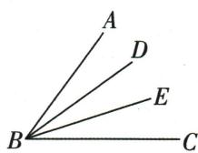
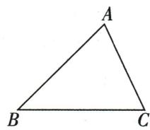
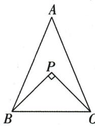

<!-- question-source:start -->
5 核心素养推理能力 [难]【概念认识】如图(1), 在 $\angle ABC$ 中, 若 $\angle ABD = \angle DBE = \angle EBC$ , 则 $BD$ , $BE$ 叫作 $\angle ABC$ 的“三分线”. 其中, $BD$ 是“邻 $AB$ 三分线”, $BE$ 是“邻 $BC$ 三分线”.

(1) 如图(2), 在 $\triangle ABC$ 中, $\angle A = 70^{\circ}$ , $\angle B = 45^{\circ}$ , 若 $\angle B$ 的“三分线” $BD$ 交 $AC$ 于点 $D$ , 则 $\angle BDC =$ \_\_\_\_;

(2) 如图 (3), 在 $\triangle ABC$ 中, $BP, CP$ 分别是 $\angle ABC$ 的“邻 $AB$ 三分线”和 $\angle ACB$ 的“邻 $AC$ 三分线”, 且 $BP \perp CP$ , 求 $\angle A$ 的度数;

(3) 在 $\triangle ABC$ 中, $\angle ACD$ 是 $\triangle ABC$ 的外角, $\angle ABC$ 的“三分线”所在的直线与 $\angle ACD$ 的“三分线”所在的直线交于点 $P$ . 若 $\angle A = m^{\circ}$ , $\angle ABC = n^{\circ}$ , 请直接写出 $\angle BPC$ 的度数. (用含 $m, n$ 的代数式表示)

图(1)

图(2)

图(3)

建议用时 60 分钟 答案 D10
<!-- question-source:end -->

![[Q00103332A1]]
