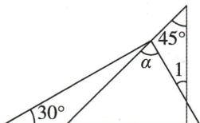

> [!success]- 必刷题
>
> > [!success] **【答案】** D
>
> > [!note]- **【解析】**
> > 如图, 由题意得 $\angle 1 = 90^{\circ} - 60^{\circ} = 30^{\circ}$ , 所以 $\angle \alpha = 45^{\circ} + 30^{\circ} = 75^{\circ}$ , 故选 D.
> >
> > 
> >
> > 易错警示
> > 点 P 的位置
> > 需分两种情形: 点 P 在线段 CD 上或在线段 AD 上, 不要漏解.
