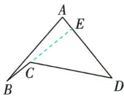

> [!success]- 必刷题
>
> > [!success] **【答案】** D
>
> > [!note]- **【解析】**
> > 根据图形可知 $\angle A$ 不一定等于 $\angle E, \angle C$ 不等于 $\angle E, \angle B$ 不一定等于 $\angle E + \angle F. \because \angle D$ 相当于 $\triangle ABC$ 的外角, $\therefore \angle D = \angle A + \angle B$ , 故选项 A、B、C 不符合题意, 选项 D 符合题意. 故选 D.
> >
> > $$
> > \triangle A B E
> > $$
> >
> > $$
> > E. \because \angle B E D
> > $$
> >
> > $$
> > \angle A =
> > $$
> >
> > 
> >
> > $$
