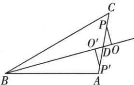

> [!success]- 必刷题
>
> > [!success] **【答案】** $25^{\circ}$ 或 $155^{\circ}$
>
> > [!note]- **【解析】**
> > 如图. ∵ BD 平分 $\angle ABC$ ,
> > ∴ $\angle ABD = \frac{1}{2} \angle ABC = 15^{\circ}$ . 当点 P 在线段 CD
> >
> > 上时，∵ $\angle PDO =$ $\angle ADB = 180^{\circ} - \angle A -$ $\angle ABD = 180^{\circ} - 100^{\circ} -$ $15^{\circ}=65^{\circ}, OP\perp BD,$
> >
> > 
> >
> > $\therefore \angle POD = 90^{\circ}, \therefore \angle APO = 90^{\circ} - 65^{\circ} = 25^{\circ}$ ; 当点 $P$ 在线段 $AD$ 上时, 如点 $P'$ , $\angle AP'O' = \angle P'O'D + \angle P'DO' = 90^{\circ} + 65^{\circ} = 155^{\circ}$ , 故答案为 $25^{\circ}$ 或 $155^{\circ}$ .
