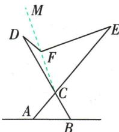

> [!success]- 必刷题
>
> > [!success] **【答案】** D
>
> > [!note]- **【解析】**
> > 连接 CF 并延长至点 M，如图所示。在 $\triangle ABC$ 中， $\angle BAC = 50^{\circ}$ ， $\angle ABC = 60^{\circ}$ ， $\therefore \angle ACB = 180^{\circ} - \angle CAB - \angle CBA =$
> >
> > 
> >
> > $180^{\circ} - 50^{\circ} - 60^{\circ} = 70^{\circ}, \therefore \angle DCE = \angle ACB = 70^{\circ}.$ $\because \angle DFM = \angle DCF + \angle D, \angle EFM = \angle ECF + \angle E,$ $\therefore \angle EFD = \angle DCF + \angle ECF + \angle D + \angle E =$ $\angle DCE + \angle D + \angle E,$ 即 $130^{\circ} = 70^{\circ} + \angle D + 30^{\circ},$ $\therefore \angle D = 30^{\circ}$ ,
> >
> > 故选 **D**.
