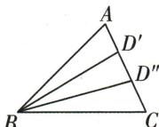
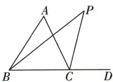
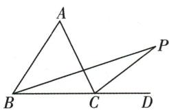
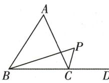
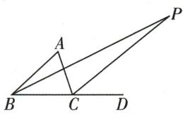
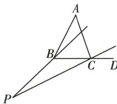

> [!success]- 必刷题
>
> > [!success] **【答案】** $85^{\circ}$ 或 $100^{\circ}$
>
> > [!note]- **【解析】**
> > 【解】(1)如图(1), 当 BD 是 “邻 AB 三分线”时, $\angle ABD' = \frac{1}{3} \times 45^{\circ} = 15^{\circ}, \therefore \angle BD'C = 70^{\circ} + 15^{\circ} = 85^{\circ}$ ; 当 BD 是 “邻
> >
> > 
> > 图(1)
> >
> > $70^{\circ} + 15^{\circ} = 85^{\circ}$ ; 当 $BD$ 是“邻 $BC$ 三分线”时, $\angle ABD'' = \frac{2}{3} \times 45^{\circ} = 30^{\circ}$ , $\therefore \angle BD''C = 70^{\circ} + 30^{\circ} = 100^{\circ}$ . 故答案为 $85^{\circ}$ 或 $100^{\circ}$ . (2) $\because BP \perp CP, \therefore \angle BPC = 90^{\circ}, \therefore \angle PBC + \angle PCB = 90^{\circ}$ . 又 $\because BP, CP$ 分别是 $\angle ABC$ 的“邻 $AB$ 三分线”和 $\angle ACB$ 的“邻 $AC$ 三分线”, $\therefore \angle PBC = \frac{2}{3} \angle ABC$ , $\angle PCB = \frac{2}{3} \angle ACB$ , $\therefore \frac{2}{3} \angle ABC + \frac{2}{3} \angle ACB = 90^{\circ}, \therefore \angle ABC + \angle ACB = 135^{\circ}$ . 在 $\triangle ABC$ 中, $\angle A + \angle ABC + \angle ACB = 180^{\circ}, \therefore \angle A = 180^{\circ} - (\angle ABC + \angle ACB) = 45^{\circ}$ . (3) $\angle BPC$ 的度数为 $\frac{2}{3} m^{\circ}$ 或 $\frac{1}{3} m^{\circ}$ 或 $\frac{2}{3} m^{\circ} + \frac{1}{3} n^{\circ}$ 或 $\frac{1}{3} m^{\circ} - \frac{1}{3} n^{\circ}$ 或 $\frac{1}{3} n^{\circ} - \frac{1}{3} m^{\circ}$ . 分四种情况进行画图计算: ①如图(2), 当 $BP$ 和 $CP$ 分别是“邻 $AB$ 三分线”“邻 $AC$ 三分线”时, $\angle BPC = \frac{2}{3} \angle A = \frac{2}{3} m^{\circ}$ ;
> >
> > 思路分析
> > (3) 根据 $\angle ABC$ 的“三分线”所在的直线与 $\angle ACD$ 的“三分线”所在的直线交于点 $P$ , 分四种情况画图: 情况一, 当 $BP$ 和 $CP$ 分别是“邻 $AB$ 三分线”“邻 $AC$ 三分线”时; 情况二, 当 $BP$ 和 $CP$ 分别是“邻 $BC$ 三分线”“邻 $CD$ 三分线”时; 情况三, 当 $BP$ 和 $CP$ 分别是“邻 $BC$ 三分线”“邻 $AC$ 三分线”时; 情况四, 当 $BP$ 和 $CP$ 分别是“邻 $AB$ 三分线”“邻 $CD$ 三分线”时, 再根据 $\angle A = m^{\circ}$ , $\angle ABC = n^{\circ}$ , 求出 $\angle BPC$ 的度数.
> >
> > 
> > 图(2)
> >
> > 
> > 图(3)
> > - **②**：如图(3)，当 BP 和 CP 分别是“邻 BC 三分线”“邻 CD 三分线”时， $\angle BPC=\frac{1}{3}\angle A=\frac{1}{3}m^{\circ}$ ;
> > - **③**：如图(4)，当 BP 和 CP 分别是“邻 BC 三分线”“邻 AC 三分线”时， $\angle BPC = \frac{2}{3} \angle A + \frac{1}{3} \angle ABC = \frac{2}{3} m^{\circ} + \frac{1}{3} n^{\circ};$ ④如图(5)、图(6)，当BP
> >
> > 
> > 图(4)
> > - **④**：如图(5)、图(6)，当 $BP$ 和 $CP$ 分别是“邻 $AB$ 三分线”“邻 $CD$ 三分线”时，
> >
> > 
> >
> > 
> > 图(5)
> > 图(6)
> >
> > 当 $m > n$ 时， $\angle BPC = \frac{1}{3}\angle A - \frac{1}{3}\angle ABC = \frac{1}{3} m^{\circ} - \frac{1}{3} n^{\circ}$ ；当 $m < n$ 时， $\angle BPC = \frac{1}{3}\angle ABC - \frac{1}{3}\angle A = \frac{1}{3} n^{\circ} - \frac{1}{3} m^{\circ}$ . 综上所述， $\angle BPC$ 的度数为 $\frac{2}{3} m^{\circ}$ 或 $\frac{1}{3} m^{\circ}$ 或 $\frac{2}{3} m^{\circ} + \frac{1}{3} n^{\circ}$ 或 $\frac{1}{3} m^{\circ} - \frac{1}{3} n^{\circ}$ 或 $\frac{1}{3} n^{\circ} - \frac{1}{3} m^{\circ}$ .
