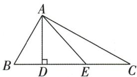
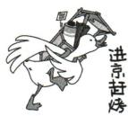

<!-- question-source:start -->
1[2024 陕西中考]如图, 在 $\triangle ABC$ 中, $\angle BAC = 90^{\circ}$ , $AD$ 是 $BC$ 边上的高, $E$ 是 $DC$ 的中点, 连接 $AE$ , 则图中的直角三角形共有 ( )

A. 2 个 B. 3 个 C. 4 个 D. 5 个
<!-- question-source:end -->

![[Q00104061A1]]
