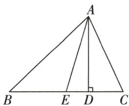
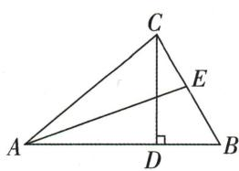

<!-- question-source:start -->
4[2024 山东德州中考]如图,在 $\triangle ABC$ 中, $AD$ 是高, $AE$ 是中线, $AD=4,S_{\triangle ABC}=12$ ,则 $BE$ 的长为
() A. 1.5 B. 3 C. 4 D. 6

(第 4 题图)

(第 5 题图)
<!-- question-source:end -->

![[Q00104064A1]]
