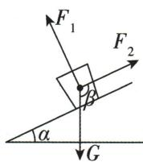
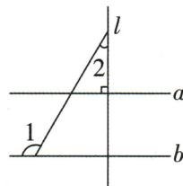

<!-- question-source:start -->
6 新考向 跨学科综合 [2024 山西中考] 一只杯子静止在斜面上, 其受力分析如图所示, 重力 $G$ 的方向竖直向下, 支持力 $F_{1}$ 的方向与斜面垂直, 摩擦力 $F_{2}$ 的方向与斜面平行. 若斜面的坡角 $\alpha = 25^{\circ}$ , 则摩擦力 $F_{2}$ 与重力 $G$ 方向的夹角 $\beta$ 的度数为 ( )
A. $155^{\circ}$ B. $125^{\circ}$ C. $115^{\circ}$ D. $65^{\circ}$

(第6题图)
(第8题图)
<!-- question-source:end -->

![[Q00104066A1]]
