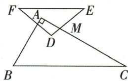
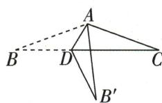

<!-- question-source:start -->
9 [四川绵阳中考]两个三角形如图摆放,其中 $\angle BAC=90^{\circ},\angle EDF=100^{\circ}$ , $\angle B=60^{\circ},\angle F=40^{\circ},DE$ 与 $AC$ 交于点 $M$ ,若 $BC//EF$ ,则 $\angle DMC$ 的大小为\_

(第9题图)

(第 10 题图)
<!-- question-source:end -->

![[Q00104069A1]]
