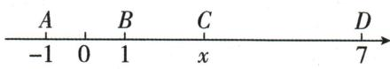

<!-- question-source:start -->
4[2025 山东临沂质检]如图,已知数轴上点 A, B, C, D 对应的数字分别为 -1, 1, x, 7, 点 C 在线段 BD 上且不与端点重合, 若线段 AB, BC, CD 能围成三角形, 则 x 可能是 ( )

A. 2 B. 3 C. 4 D. 5
<!-- question-source:end -->

![[Q00104074A1]]
