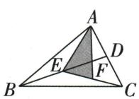
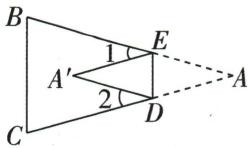

<!-- question-source:start -->
5[2024 天津南开区期中]如图,在 $\triangle ABC$ 中, $D$ , $E,F$ 分别是边 $AC,BD,CE$ 的中点,且阴影部分的面积为7,则 $\triangle ABC$ 的面积为 ( )
A.14 B.21 C.28 D.32

(第 5 题图)
(第6题图)
<!-- question-source:end -->

![[Q00104075A1]]
