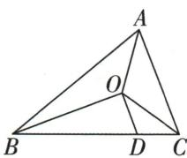
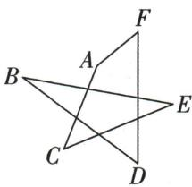

<!-- question-source:start -->
7 如图, 在 $\triangle ABC$ 中, $O$ 是三个内角的平分线的交点, 过点 $O$ 作 $\angle ODC = \angle AOC$ , 交边 $BC$ 于点 $D$ . 若 $\angle ABC = n^{\circ}$ , 则 $\angle BOD$ 的度数为 ( )

A. $90^{\circ} + \frac{1}{2} n^{\circ}$ B. $45^{\circ} + \frac{1}{2} n^{\circ}$ C. $90^{\circ} - \frac{1}{2} n^{\circ}$ D. $90^{\circ}$

(第7题图)
(第8题图)
<!-- question-source:end -->

![[Q00104077A1]]
