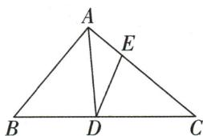
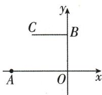

<!-- question-source:start -->
13 如图, 在 $\triangle ABC$ 中, $\angle B = 50^{\circ}, \angle C = 40^{\circ}, \angle BAC$ 的平分线交 $BC$ 于点 $D$ , 点 $E$ 是 $AC$ 边上的一个动点, 当

$\triangle ADE$ 是钝角三角形时, $\angle ADE$ 的取值范围是 \_\_\_\_.

(第 13 题图)

(第 14 题图)
<!-- question-source:end -->

![[Q00104083A1]]
