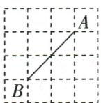
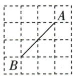
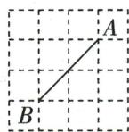

<!-- question-source:start -->
15[2025 吉林长春期末]图(1)、图(2)、图(3)均是 $4 \times 4$ 的正方形网格, 每个小正方形的边长均为 1 , 小正方形的顶点称为格点, 线段 $AB$ 的端点均在格点上, 只用无刻度的直尺, 在给定的网格中, 按下列要求以 $AB$ 为边画 $\triangle ABC$ . 要求: (1) 在图(1)中画一个直角三角形, 在图(2)中画一个锐角三角形, 在图(3)中画一个钝角三角形.

(2) 点 C 在格点上.

图(1)

图(2)

图(3)
<!-- question-source:end -->

![[Q00104085A1]]
