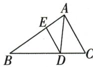

<!-- question-source:start -->
16[2024 江苏南京建邺区校级期末]如图, 在 $\triangle ABC$ 中, $\angle B = 35^{\circ}$ , 点 $D$ 在 $BC$ 上, $\angle BAC = \angle ADC$ , 点 $E$ 在 $AB$ 上, 连接 $AD, DE$ . (1) 若 $DE \parallel AC$ , 求 $\angle ADE$ 的度数.

(2) 当 $\angle BED$ 的度数是 \_\_\_\_ 时, $\triangle BDE$ 是直角三角形.

<!-- question-source:end -->

![[Q00104086A1]]
