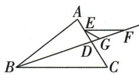
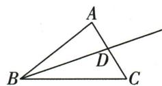

<!-- question-source:start -->
17[2024 河北邯郸期末]在 $\triangle ABC$ 中, $BD$ 平分 $\angle ABC$ 交 $AC$ 于点 $D$ , 点 $E$ 是线段 $AC$ 上的动点 (不与点 $D$ 重合), 过点 $E$ 作 $EF \parallel BC$ 交射线 $BD$ 于点 $F$ , $\angle CEF$ 的平分线所在直线与射线 $BD$ 交于点 $G$ .

(1)如图,点E在线段AD上运动时,
①若 $\angle ABC=40^{\circ},\angle C=60^{\circ}$ ,则 $\angle A$ 的度数是
\_\_\_\_, $\angle EFB$ 的度数是\_\_\_\_.
②猜想 $\angle BGE$ 与 $\angle A$ 之间的数量关系,并说明理由.

(2) 若点 E 在线段 DC 上运动时, 请直接写出 $\angle BGE$ 与 $\angle A$ 之间的数量关系.

备用图

电子错题本鸭
<!-- question-source:end -->

![[Q00104087A1]]
