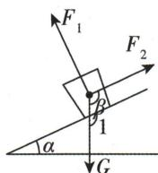

> [!success]- 必刷题
>
> > [!success] **【答案】** C
>
> > [!note]- **【解析】**
> > 如图, ∵ 重力 G 的方向竖直向下, ∴ 重力 G 与水平方向夹角为 $90^{\circ}$ . ∵ 摩擦力 $F_{2}$ 的方向与斜面平行, $\alpha = 25^{\circ}$ , ∴ $\beta = \angle 1 = \alpha + 90^{\circ} = 25^{\circ} + 90^{\circ} = 115^{\circ}$ , 故选 C.
> >
> > 
