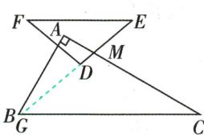
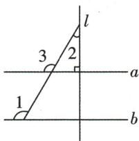

> [!success]- 必刷题
>
> > [!success] **【答案】** 30
>
> > [!note]- **【解析】**
> > 如图. $\because a // b, \therefore \angle 3 = \angle 1 = 120^{\circ}$ . $\because l \perp a, \therefore \angle 3 = \angle 2 + 90^{\circ}, \therefore \angle 2 = 30^{\circ}$ . 故答案为 30.
> >
> > (第9题图)
> > 
> >
> > (第8题图)
> > 
