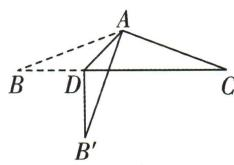
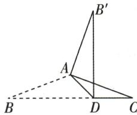

> [!success]- 必刷题
>
> > [!success] **【答案】** $25^\circ$ 或 $115^\circ$
>
> > [!note]- **【解析】**
> > 由折叠的性质得 $\angle ADB' = \angle ADB$ . ∵ $B'D \perp BC$ , ∴ $\angle BDB' = 90^\circ$ . 分两种情况讨论: ①当 $B'$ 在 BC 下方时, 如图(1). ∵ $\angle ADB + \angle ADB' + \angle BDB' = 360^\circ$ , ∴ $\angle ADB = \frac{1}{2} \times (360^\circ - 90^\circ) = 135^\circ$ , ∴ $\angle BAD = 180^\circ - \angle B - \angle ADB = 25^\circ$ .
> >
> > 
> > 图(1)
> >
> > 
> > 图(2)
> > - **②**：当 $B'$ 在 $BC$ 上方时, 如图(2). $\because \angle ADB + \angle ADB' = 90^\circ$ , $\therefore \angle ADB = \frac{1}{2} \times 90^\circ = 45^\circ$ , $\therefore \angle BAD = 180^\circ - \angle B - \angle ADB = 115^\circ$ . 综上, $\angle BAD$ 的度数为 $25^\circ$ 或 $115^\circ$ . 故答案为 $25^\circ$ 或 $115^\circ$ .
