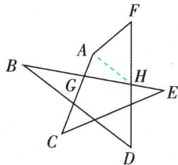

> [!success]- 必刷题
>
> > [!success] **【答案】** B
>
> > [!note]- **【解析】**
> > 如图所示, 连接 AH, 设 AC 与 BE 交于点 G. 由三角形外角性质可知 $\angle AGH = \angle C + \angle E$ , $\angle FHG = \angle B + \angle D$ . $\because \angle FAG = \angle FAH + \angle GAH$ , $\angle FHG = \angle FHA + \angle GHA$ . 在 $\triangle AGH$ 中, $\angle AGH + \angle GHA + \angle HAG = 180^{\circ}$ ; 在 $\triangle AFH$ 中, $\angle F + \angle FHA + \angle HAF = 180^{\circ}$ , $\therefore \angle F + \angle FAG + \angle AGH + \angle FHG = 360^{\circ}$ , $\therefore \angle FAG + \angle B + \angle C + \angle D + \angle E + \angle F = 360^{\circ}$ , 故选 B.
> >
> > 
