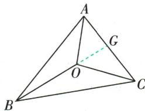

> [!success]- 必刷题
>
> > [!success] **【答案】** D
>
> > [!note]- **【解析】**
> > 如图, $\because OA + OB > AB, OB + OC > BC, OC + OA > AC, \therefore 2(OA + OB + OC) > AB + BC + AC, \therefore 2S_{1} > S_{2}$ . 延长 BO 交 AC 于点 G. $\because AB + AG > BO + OG, OG + GC > OC, \therefore AB + AC > OB + OC$ , 同理可得, $AB + BC > OA + OC, AC + BC > OA + OB, \therefore 2(AB + BC + AC) > 2(OA + OB + OC), \therefore S_{2} > S_{1}, \therefore S_{2} < 2S_{1} < 2S_{2}$ . 故选 D.
> >
> > 
> >
> > 11.1 【解析】根据三角形具有稳定性可知,要使这个木架不变形,他至少要再钉上1根木条,故答案为1.
