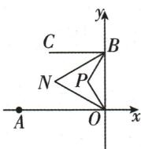
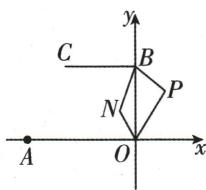

> [!success]- 必刷题
>
> > [!success] **【答案】** $\angle BNO + \frac{1}{2}\angle BPO = 180^{\circ}$ 或 $\angle BPO = 2\angle BNO$
>
> > [!note]- **【解析】**
> > - **①**：如图(1)，当点 $P$ 在 $OB$ 左侧时， $\angle BPO = 2\angle BNO.$ 理由如下：在 $\triangle BPO$ 中， $\angle PBO + \angle POB = 180^{\circ} - \angle BPO.$ 由题可知 $BC // OA, BN$ 平分 $\angle CBP, ON$ 平分 $\angle AOP,$ $\therefore \angle NBP + \angle NOP = \frac{1}{2}(180^{\circ} - \angle PBO -$ $\angle POB)$ . 在 $\triangle NOB$ 中, $\angle BNO = 180^{\circ} - (\angle NBP + \angle NOP + \angle PBO + \angle POB) = 180^{\circ} - \left[\frac{1}{2}(180^{\circ} - \angle PBO - \angle POB) + \angle PBO + \angle POB\right] = 90^{\circ} - \frac{1}{2} (\angle PBO + \angle POB) = 90^{\circ} - \frac{1}{2}(180^{\circ} - \angle BPO) = \frac{1}{2}\angle BPO, \therefore \angle BPO = 2\angle BNO.$
> >
> > 易错警示
> >
> > 
> >
> > 没有说明 $\triangle BDE$ 中哪个角是直角,需要分 $\angle BED=90^{\circ}$ 或 $\angle BDE=90^{\circ}$ 两种情况讨论,避免漏解.
> >
> > 
> > 图(1)
> > 图(2)
> > - **②**：如图(2)，当点 $P$ 在 $OB$ 右侧时， $\angle BNO + \frac{1}{2}\angle BPO = 180^{\circ}$ 。理由如下： $\because BC \parallel OA$ ， $\therefore$ 易得 $\angle CBP + \angle AOP + \angle BPO = 360^{\circ}$ 。 $\because BN$ 平分 $\angle CBP, ON$ 平分 $\angle AOP, \therefore \angle PBN + \angle PON + \frac{1}{2} \angle BPO = \frac{1}{2} \times 360^{\circ} = 180^{\circ}$ ， $\therefore \angle PBN + \angle PON = 180^{\circ} - \frac{1}{2} \angle BPO.$ 在四边形 $BNOP$ 中， $\angle BNO = 360^{\circ} - \angle PBN - \angle PON - \angle BPO = 360^{\circ} - \left(180^{\circ} - \frac{1}{2} \angle BPO\right) - \angle BPO = 180^{\circ} - \frac{1}{2} \angle BPO, \therefore \angle BNO + \frac{1}{2} \angle BPO = 180^{\circ}$ 。综上， $\angle BPO$ 与 $\angle BNO$ 之间的数量关系为 $\angle BNO + \frac{1}{2} \angle BPO = 180^{\circ}$ 或 $\angle BPO = 2\angle BNO.$
