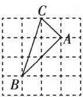
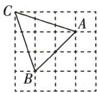
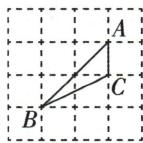

> [!success]- 必刷题
>
> > [!success] **【答案】** 详见解析
>
> > [!note]- **【解析】**
> > 【解】如图所示.(答案不唯一)
> >
> > 
> > 图(1)
> >
> > 
> > 图(2)
> >
> > 
> > 图(3)
> >
> > 需要对点 P 的位置进行分类讨论: ① 点 P 在 OB 的左侧;
> > - **②**：点 P 在 OB 的右侧. 避免漏解.
> >
> > ## 易错警示
