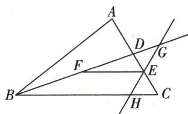

> [!success]- 必刷题
>
> > [!success] **【答案】** $80^{\circ}, 20^{\circ}
>
> > [!note]- **【解析】**
> > 【解】(1)①∵ $\angle ABC = 40^{\circ}, \angle C = 60^{\circ}, \therefore$ 在 $\triangle ABC$ 中， $\angle A = 180^{\circ} - \angle ABC - \angle C = 180^{\circ} - 40^{\circ} - 60^{\circ} = 80^{\circ}.$ ∵ $EF \parallel BC, \therefore \angle EFB = \angle FBC.$ ∵ BD 平分 $\angle ABC, \therefore \angle FBC = \frac{1}{2} \angle ABC = 20^{\circ}, \therefore \angle EFB = \angle FBC = 20^{\circ}$ ，故答案为 $80^{\circ}, 20^{\circ}.$ ② $\angle BGE = 90^{\circ} - \frac{1}{2} \angle A.$ 理由：∵ $\angle BGE$ 是 $\triangle EGF$ 的一个外角，∴ $\angle BGE = \angle EFG + \angle FEG.$ ∵ $EF \parallel BC, \therefore \angle C = \angle DEF.$ ∵ $\angle ABC + \angle C = 180^{\circ} - \angle A, \therefore \angle ABC + \angle DEF = 180^{\circ} - \angle A.$ ∵ BD 平分 $\angle ABC, EG$ 平分 $\angle CEF,$ ∴ $\angle CBD = \frac{1}{2} \angle ABC, \angle FEG = \frac{1}{2} \angle DEF,$ ∴ $\angle CBD + \angle FEG = \frac{1}{2} \angle ABC + \frac{1}{2} \angle DEF = \frac{1}{2} \times (180^{\circ} - \angle A) = 90^{\circ} - \frac{1}{2} \angle A.$ ∵ $EF \parallel BC,$ ∴ $\angle EFG = \angle CBD, \therefore \angle EFG + \angle FEG = 90^{\circ} - \frac{1}{2} \angle A, \therefore \angle BGE = 90^{\circ} - \frac{1}{2} \angle A.$ (2) $\angle BGE = \frac{1}{2} \angle A.$ 如图，设 $\angle CEF$ 的平分线与 BC 交于点 H.
> >
> > 
> >
> > $\because EF \parallel BC, \therefore \angle FEH = \angle EHC.$ $\because EH$ 是 $\angle FEC$ 的平分线, $\therefore \angle FEH = \angle HEC, \therefore \angle HEC = \angle EHC, \therefore \angle EHC = \frac{180^\circ - \angle C}{2}.$ $\because BG$ 平分 $\angle ABC, \therefore \angle GBC = \frac{1}{2}\angle ABC, \therefore \angle BGE = \angle EHC - \angle GBC = \frac{180^\circ - \angle C}{2} - \frac{1}{2}\angle ABC = \frac{180^\circ - \angle C - \angle ABC}{2} = \frac{1}{2}\angle A.$
> >
> > # 第十四章 全等三角形
> >
> > ## 14.1 全等三角形及其性质
> >
> > 
