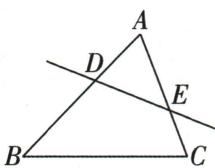
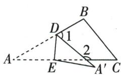

<!-- question-source:start -->
1[2024 河北唐山期末, 中]如图, $\triangle ABC$ 中, $\angle A=65^{\circ}$ , 直线 DE 交 AB 于点 D, 交 AC 于点 E,
则 $\angle BDE + \angle CED =$ ( )
A. $180^{\circ}$ B. $215^{\circ}$ C. $235^{\circ}$ D. $245^{\circ}$

(第1题图)

(第2题图)
<!-- question-source:end -->

![[Q00103333A1]]
