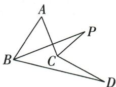

<!-- question-source:start -->
3[2024 河北唐山期末, 中]如图, $\angle ABD$ , $\angle ACD$ 的平分线交于点 P, 若 $\angle A = 55^{\circ}$ , $\angle D = 15^{\circ}$ , 则 $\angle P$ 的度数为 ( )

A. $15^{\circ}$ B. $20^{\circ}$ C. $25^{\circ}$ D. $30^{\circ}$
<!-- question-source:end -->

![[Q00103335A1]]
