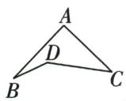
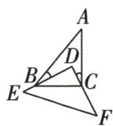
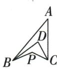

<!-- question-source:start -->
4[2024 山西大同校级质检, 中]问题情境:

如图(1)所示的图形像我们常见的学习用品——圆规. 我们不妨把这样的图形叫作“规形图”.

探究发现:

(1) 观察“规形图”, 试探究 $\angle D$ 与 $\angle BAC, \angle B$ , $\angle C$ 之间的数量关系, 并说明理由.

解决问题：

(2)请你利用以上结论,解决下列问题:

①如图(2)，把一块含 $45^{\circ}$ 角的三角尺DEF放置在 $\triangle ABC$ 上，使三角尺的两条直角边DE,DF恰好经过点B,C,若 $\angle A=40^{\circ}$ ，则 $\angle ABD+\angle ACD=$ \_\_\_\_°.

②如图(3), BD 平分 $\angle ABP, CD$ 平分 $\angle ACP$ , 若 $\angle A = 40^{\circ}, \angle P = 130^{\circ}$ , 则 $\angle D$ 的度数为 \_\_\_\_.

图(1)
图(2)

图(3)
<!-- question-source:end -->

![[Q00103336A1]]
