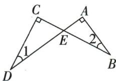

<!-- question-source:start -->
5[中]如图, $\angle A=\angle C=90^{\circ},AD,BC$ 交于点E, $\angle2=27^{\circ}$ ,则 $\angle1$ 的度数为()

A. $53^{\circ}$ B. $43^{\circ}$ C. $37^{\circ}$ D. $27^{\circ}$
<!-- question-source:end -->

![[Q00103337A1]]
