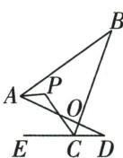

<!-- question-source:start -->
6[2024 湖北武汉校级期中, 中]如图, $\angle BAD$ 与 $\angle BCE$ 的平分线交于点 P, BC 交 AD 于 O, CE 的反向延长线交 AD 于 D, 则 $\angle P$ 与 $\angle B$ , $\angle D$ 的数量关系是 ( )

A. $2\angle P - \angle B + \angle D = 180^{\circ}$ B. $2\angle P - \angle B - \angle D = 180^{\circ}$ C. $2\angle P + \angle B - \angle D = 180^{\circ}$ D. $2\angle P + \angle B + \angle D = 360^{\circ}$

<!-- question-source:end -->

![[Q00103338A1]]
