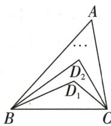

<!-- question-source:start -->
7[中]如图, 在 $\triangle ABC$ 中, $\angle A = 52^{\circ}$ , $\angle ABC$ 与 $\angle ACB$ 的平分线交于点 $D_{1}, \angle ABD_{1}$ 与 $\angle ACD_{1}$ 的平分线交于点 $D_{2}, \cdots$ , 依次类推, $\angle ABD_{3}$ 与 $\angle ACD_{3}$ 的平分线交于点 $D_{4}$ , 则 $\angle D_{4}$ 的度数是 \_\_\_\_.

<!-- question-source:end -->

![[Q00103339A1]]
