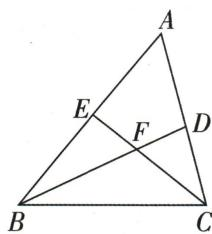

<!-- question-source:start -->
8[中]如图, $\triangle ABC$ 的角平分线BD,CE相交于点F.

(1) 若 $\angle A = 54^{\circ}$ ，求 $\angle CFD$ 的度数；

(2)试说明: $2\angle BFC=\angle A+180^{\circ}$ .

<!-- question-source:end -->

![[Q00103340A1]]
