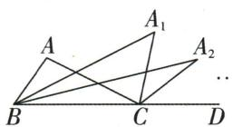

<!-- question-source:start -->
9[较难]如图,在 $\triangle ABC$ 中, $\angle A=\alpha$ , $\angle ABC$ 的平分线与 $\triangle ACB$ 的外角( $\angle ACD$ )的平分线交于点 $A_{1}$ ; $\angle A_{1}BC$ 的平分线与 $\triangle A_{1}CB$ 的外角( $\angle A_{1}CD$ )的平分线交于点 $A_{2}$ , $\cdots$ ,以此类推,则 $\angle A_{2022}=$ \_\_\_\_.(用含 $\alpha$ 的式子表示)

<!-- question-source:end -->

![[Q00103341A1]]
