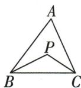
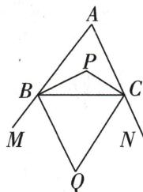

<!-- question-source:start -->
10[2025 广东湛江校级期中, 中] 在 $\triangle ABC$ 中, $\angle ABC$ 与 $\angle ACB$ 的平分线相交于点 $P$ .

(1) 如图 (1), 若 $\angle BPC = \alpha$ , 则 $\angle A =$ \_\_\_\_; (用含 $\alpha$ 的代数式表示)

(2) 如图 (2), 作 $\triangle ABC$ 外角 $\angle MBC$ , $\angle NCB$ 的平分线交于点 $Q$ , 试探究 $\angle Q$ 与 $\angle BPC$ 之间的数量关系, 并说明理由.

图(1)
图(2)
<!-- question-source:end -->

![[Q00103342A1]]
