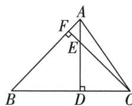

<!-- question-source:start -->
11[2024 河南周口期末, 中]如图, 在 $\triangle ABC$ 中, $AB = 8, BC = 10, CF \perp AB$ 于点 $F, AD \perp BC$ 于点 $D, AD$ 与 $CF$ 交于点 $E, \angle B = 46^{\circ}$ .

(1) 求 $\angle AEC$ 的度数.

(2) 若 $AD = 6$ , 求 $CF$ 的长.

<!-- question-source:end -->

![[Q00103343A1]]
