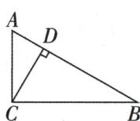
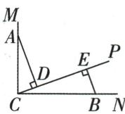
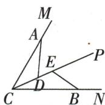

<!-- question-source:start -->
12[较难](1)探究:如图(1),在 $\triangle ABC$ 中, $\angle ACB=90^{\circ},CD\perp AB$ 于点 $D$ ,若 $\angle B=30^{\circ}$ ,则 $\angle ACD$ 的度数是\_\_\_\_°; (2)拓展:如图(2), $\angle MCN=90^{\circ}$ ,射线 $CP$ 在 $\angle MCN$ 的内部,点 $A,B$ 分别在 $CM,CN$ 上,分别过点 $A,B$ 作 $AD\perp CP,BE\perp CP$ ,垂足分别为 $D,E$ ,若 $\angle CBE=70^{\circ}$ ,求 $\angle CAD$ 的度数; (3)应用:如图(3),点 $A,B$ 分别在 $\angle MCN$ 的边 $CM,CN$ 上,射线 $CP$ 在 $\angle MCN$ 的内部,点 $D,E$ 在射线 $CP$ 上,连接 $AD,BE$ ,若 $\angle ADP=\angle BEP=60^{\circ}$ ,则 $\angle CAD+\angle CBE+\angle ACB=$ \_\_\_\_°.

图(1)

图(2)

图(3)
<!-- question-source:end -->

![[Q00103344A1]]
