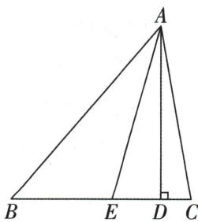

<!-- question-source:start -->
13[2025 浙江温州质检, 中]如图, $\triangle ABC$ 中, $AD$ 是 $BC$ 边上的高, $AE$ 是 $\angle BAC$ 的平分线, $\angle EAD = 15^{\circ}, \angle B = 50^{\circ}$ , 求 $\angle C$ 的度数.

<!-- question-source:end -->

![[Q00103345A1]]
