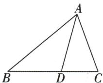
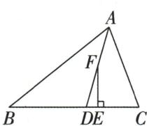
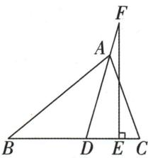
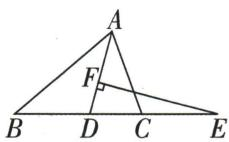
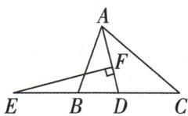

<!-- question-source:start -->
14[2024 河南新乡期中,较难]综合与实践课上,老师让同学们以“三角形的角与三角形的特殊线段”为主题开展数学活动.

【操作判断】(1)在 $\triangle ABC$ 中, $\angle B=40^{\circ},\angle C=70^{\circ}$ ,作 $\angle BAC$ 的平分线 $AD$ 交 $BC$ 于点 $D$ .

①操作一:在图(1)中,用三角尺作 $BC$ 边上的高 $AE$ ,垂足为点 $E$ ,求 $\angle DAE$ 的度数;

②操作二:如图(2),在 $AD$ 上任取点 $F$ ,作 $FE\perp BC$ ,垂足为点 $E$ ,直接写出 $\angle DFE$ 的度数.

【迁移探究】(2)如图(3),将操作二中“在 $AD$ 上任取点 $F$ ”改为“在 $DA$ 的延长线上任取点 $F$ ”,其他条件不变,判断 $\angle DFE$ 的度数是否会发生变化,并说明理由.

【拓展应用】(3)如图(4)、图(5),在 $\triangle ABC$ 中, $\angle ABC=\alpha,\angle ACB=\beta,AD$ 是 $\angle BAC$ 的平分线,在直线 $AD$ 上任取点 $F$ ,过点 $F$ 作 $EF\perp AD$ 与直线 $BC$ 交于点 $E$ ,请求出 $\angle DEF$ 与 $\alpha,\beta$ 之间的数量关系.

图(1)

图(2)

图(3)

图(4)

图(5)
<!-- question-source:end -->

![[Q00103346A1]]
