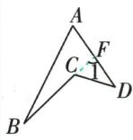

> [!success]- 必刷题
>
> > [!success] **【答案】** B
>
> > [!note]- **【解析】**
> > ∵ $\angle1=70^{\circ},\angle2=140^{\circ},\therefore\angle B+\angle C=360^{\circ}-\angle1-\angle2=360^{\circ}-70^{\circ}-140^{\circ}=150^{\circ},$ ∴ $\angle A=180^{\circ}-(\angle B+\angle C)=180^{\circ}-150^{\circ}=30^{\circ}.$ 故选 B.
> >
> > 大招解读 | 飞镖型（或燕尾型）
> > 结论:如图, $\angle BCD = \angle A + \angle B + \angle D.$ 证明:延长BC交AD于点F.
> > ∵ $\angle1 = \angle A + \angle B$ , $\angle BCD = \angle1 + \angle D,$ ∴ $\angle BCD = \angle A + \angle B + \angle D.$
> >
> > 
