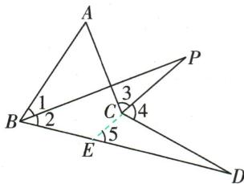

> [!success]- 必刷题
>
> > [!success] **【答案】** B
>
> > [!note]- **【解析】**
> > 如图, 延长 $PC$ 交 $BD$ 于 $E$ . $\because \angle ABD, \angle ACD$ 的平分线交于点 $P, \therefore \angle 1 = \angle 2, \angle 3 = \angle 4$ . 由三角形的内角和定理得, $\angle A + \angle 1 = \angle P + \angle 3$ . ① 在 $\triangle PBE$ 中, $\angle 5 = \angle 2 + \angle P$ , 在 $\triangle DCE$ 中, $\angle 5 = \angle 4 - \angle D$ , $\therefore \angle 2 + \angle P = \angle 4 - \angle D$ . ② ①-②得 $\angle A - \angle P = \angle P + \angle D$ , $\therefore \angle P = \frac{1}{2} (\angle A - \angle D)$ . $\because \angle A = 55^{\circ}, \angle D = 15^{\circ}, \therefore \angle P = \frac{1}{2} (55^{\circ} - 15^{\circ}) = 20^{\circ}$ . 故选 B.
> >
> > 
> >
> > 思路分析
> > 设 $\angle PAB = \angle OAP = x,$ $\angle ECP = \angle PCB = y,$ 则 $\angle BAO = 2x, \angle BCE = 2y,$ 利用 8 字型模型得出 $\angle B + \angle BAO = \angle D + \angle OCD,$ $\angle P + \angle PAG = \angle D + \angle GCD,$ 然后构建方程组即可解决问题.
