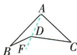
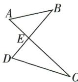

> [!success]- 必刷题
>
> > [!success] **【答案】** 50
>
> > [!note]- **【解析】**
> > 【解】(1) $\angle BDC=\angle BAC+\angle B+\angle C.$ 理由:如图,连接AD并延长至点F.
> >
> > 
> >
> > 根据外角的性质,可得 $\angle BDF=\angle BAD+\angle B$ ， $\angle CDF=\angle C+\angle CAD.$ 又 $\because \angle BDC=\angle BDF+\angle CDF,\angle BAC=\angle BAD+\angle CAD,\therefore \angle BDC=\angle BAC+\angle B+\angle C.$ (2)①由(1)可得 $\angle D=\angle ABD+\angle ACD+\angle A.$ 又 $\because \angle A=40^{\circ},\angle D=90^{\circ},\therefore \angle ABD+\angle ACD=90^{\circ}-40^{\circ}=50^{\circ}$ ,故答案为50.
> > - **②**：由(1)可得 $\angle P=\angle A+\angle ABP+\angle ACP,\angle D=\angle A+\angle ABD+\angle ACD,\therefore \angle ABP+\angle ACP=\angle P-\angle A=130^{\circ}-40^{\circ}=90^{\circ}.$
> >
> > 思路分析
> > 根据角平分线的定义和三角形的内角和定理可得规律, 进而得到 $\angle D_{4}$ 的度数.
> >
> > 又∵ BD 平分 $\angle ABP$ , CD 平分 $\angle ACP$ , $\therefore \angle ABD + \angle ACD = \frac{1}{2} (\angle ABP + \angle ACP) = 45^{\circ}$ , $\therefore \angle D = 45^{\circ} + 40^{\circ} = 85^{\circ}$ . 故答案为 $85^{\circ}$ .
> >
> > 
> >
> > 结论:如图, $\angle A+\angle B=\angle C+\angle D.$ 证明：∵ $\angle BEC$ 是 $\triangle ABE$ 的外角，∴ $\angle BEC = \angle A + \angle B.$ ∵ $\angle BEC$ 是 $\triangle CDE$ 的外角，
> > ∴ $\angle BEC = \angle C + \angle D,$ ∴ $\angle A + \angle B = \angle C + \angle D.$
