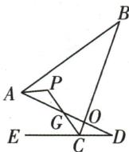

> [!success]- 必刷题
>
> > [!success] **【答案】** D
>
> > [!note]- **【解析】**
> > 由对顶角相等得 $\angle CED = \angle AEB$ .
> >
> > ∵ $\angle A = \angle C = 90^{\circ}$ , ∴ $\angle CED + \angle 1 = 90^{\circ}$ , $\angle AEB + \angle 2 = 90^{\circ}$ , ∴ $\angle 1 = \angle 2 = 27^{\circ}$ . 故选 D.
> >
> > 
