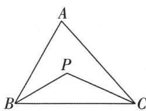

> [!success]- 必刷题
>
> > [!success] **【答案】** B
>
> > [!note]- **【解析】**
> > 如图, 设 PC 交 AD 于 G, ∠PAB = ∠OAP = x, ∠ECP = ∠PCB = y, 则 ∠BAO = 2x, ∠BCE = 2y. ∵ ∠AOB = ∠COD, ∠AGP = ∠CGD, ∴ ∠B + ∠BAO = ∠D + ∠OCD, ∠P + ∠PAG = ∠D + ∠GCD, ∴ {∠B+2x=∠D+180°-2y,①∠P+x=∠D+180°-y,②①-2×②, 可得 ∠B-2∠P=-∠D-180°, 则 2∠P-∠B-∠D=180°. 故选 B.
> >
> > 如图, $BP, CP$ 分别是 $\angle ABC, \angle ACB$ 的平分线, 则 $\angle P = 90^{\circ} + \frac{1}{2} \angle A$ .
> >
> > 
