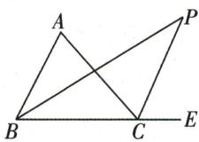

> [!success]- 必刷题
>
> > [!success] **【答案】** 详见解析
>
> > [!note]- **【解析】**
> > 【解】(1)∵∠A=54°,∴∠ABC+∠ACB=180°-∠A=180°-54°=126°.又∵BD平分∠ABC,CE平分∠ACB,∴∠CFD=∠FBC+∠FCB= $\frac{1}{2}$ (∠ABC+∠ACB)=63°.
> > (2)∵△ABC的角平分线BD,CE相交于点F,∴∠CBF= $\frac{1}{2}$ ∠ABC,∠BCF= $\frac{1}{2}$ ∠ACB,
> > ∴∠BFC=180°-∠CBF-∠BCF=180°- $\frac{1}{2}$ ∠ABC- $\frac{1}{2}$ ∠ACB=180°- $\frac{1}{2}$ (∠ABC+∠ACB).∵∠A+∠ABC+∠ACB=180°,
> > ∴∠ABC+∠ACB=180°-∠A,∴∠BFC=180°- $\frac{1}{2}$ (180°-∠A)=90°+ $\frac{1}{2}$ ∠A,即
> > 2∠BFC=∠A+180°.
> >
> > 如图，BP, CP 分别是 $\angle ABC$ , $\angle ACE$ 的平分线，则 $\angle P = \frac{1}{2} \angle A$ .
> >
> > 
> >
> > (2) 解题的关键是利用三角形内角和定理将 $\angle BFC$ 和 $\angle A$ 联系起来.
