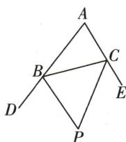

> [!success]- 必刷题
>
> > [!success] **【答案】** $\frac{1}{2^{2022}}\alpha
>
> > [!note]- **【解析】**
> > $\because \angle ACD = 180^{\circ} - \angle ACB,$ $\angle ABC$ 的平分线与 $\triangle ACB$ 的外角（ $\angle ACD$ ）的平分线交于点 $A_{1}, \therefore \angle A_{1} = 180^{\circ} - (\angle A_{1}BC + \angle ACB + \angle ACA_{1}) = 180^{\circ} - \frac{1}{2}\angle ABC - \angle ACB - \frac{1}{2}(180^{\circ} - \angle ACB) = 90^{\circ} - \frac{1}{2}(180^{\circ} - \angle A) = \frac{1}{2}\angle A.$ 同理可得 $\angle A_{2} = \frac{1}{2}\angle A_{1} = \frac{1}{2^{2}}\angle A,$ $\angle A_{3} = \frac{1}{2}\angle A_{2} = \frac{1}{2^{3}}\angle A, \cdots, \therefore \angle A_{2022} = \frac{1}{2^{2022}}\angle A.$ $\because \angle A = \alpha, \therefore \angle A_{2022} = \frac{1}{2^{2022}}\alpha.$ 故答案为 $\frac{1}{2^{2022}}\alpha.$
> >
> > 大招解读 | 双外角平分线模型
> > 如图, BP, CP 分别是 $\angle CBD, \angle BCE$ 的平分线,
> > 则 $\angle P = 90^{\circ} - \frac{1}{2} \angle A$ .
> >
> > 
> >
> > (2) 利用等面积法求出 CF 的长是解题关键.
