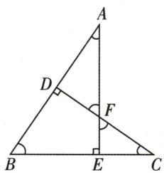
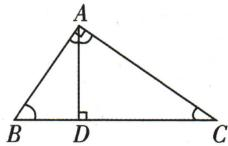

> [!success]- 必刷题
>
> > [!success] **【答案】** $2\alpha - 180^\circ$
>
> > [!note]- **【解析】**
> > 【解】(1)因为BP, CP分别平分∠ABC与∠ACB, 所以 $\angle PBC = \frac{1}{2} \angle ABC$ , $\angle PCB = \frac{1}{2} \angle ACB$ . 因为 $\angle BPC = 180^\circ - (\angle PBC + \angle PCB)$ , 所以 $\angle BPC = 180^\circ - \frac{1}{2} (\angle ABC + \angle ACB)$ , 所以 $\angle BPC = 180^\circ - \frac{1}{2} (180^\circ - \angle A) = 90^\circ + \frac{1}{2} \angle A$ . 因为 $\angle BPC = \alpha$ , 所以 $\angle A = 2\alpha - 180^\circ$ . 故答案为 $2\alpha - 180^\circ$ .
> >
> > (2) $\angle BPC + \angle Q = 180^\circ$ . 理由: 因为BQ, CQ分别平分∠MBC, ∠NCB, 所以∠QBC = $\frac{1}{2} \angle CBM$ , $\angle BCQ = \frac{1}{2} \angle BCN$ , 所以∠QBC + $\angle QCB = \frac{1}{2} (\angle CBM + \angle BCN)$ , 所以∠QBC + $\angle QCB = \frac{1}{2} (\angle A + \angle ACB + \angle A + \angle ABC) = \frac{1}{2} (180^\circ + \angle A)$ , 所以∠QBC + ∠QCB = $90^\circ + \frac{1}{2} \angle A$ , 所以 $\angle Q = 180^\circ - (90^\circ + \frac{1}{2} \angle A) = 90^\circ - \frac{1}{2} \angle A$ . 由(1)知∠BPC = $90^\circ + \frac{1}{2} \angle A$ , 所以∠BPC + ∠Q = $180^\circ$ .
> >
> > ## 大招解读 | 双垂直模型
> >
> > <table><tr><td>一般型:  结论:1∠A=∠C; 2∠B=∠AFD=∠CFE;3AB·CD=AE·BC</td><td>子母型(射影定理模型):  结论:1∠B=∠CAD; 2∠C=∠BAD; 3AB·AC=AD·BC</td></tr></table>
