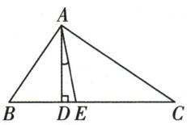
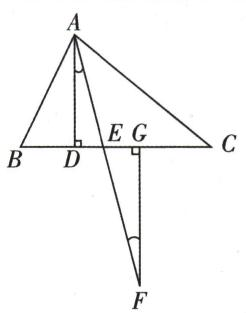

> [!success]- 必刷题
>
> > [!success] **【答案】** 30
>
> > [!note]- **【解析】**
> > 【解】(1) 在 $\triangle ABC$ 中, $\angle ACB = 90^{\circ}$ , $\angle B = 30^{\circ}$ , $\therefore \angle A = 60^{\circ}$ . $\because CD \perp AB$ , $\therefore \angle ADC = 90^{\circ}$ , $\therefore \angle ACD = 90^{\circ} - \angle A = 30^{\circ}$ . 故答案为 30.
> >
> > (2) $\because BE \perp CP$ , $\therefore \angle BEC = 90^{\circ}$ . $\because \angle CBE = 70^{\circ}$ , $\therefore \angle BCE = 90^{\circ} - \angle CBE = 20^{\circ}$ . $\because \angle MCN = 90^{\circ}$ , $\therefore \angle ACD = 90^{\circ} - \angle BCE = 70^{\circ}$ . $\because AD \perp CP$ , $\therefore \angle CAD = 90^{\circ} - \angle ACD = 20^{\circ}$ .
> >
> > (3) $\because \angle ADP$ 是 $\triangle ACD$ 的外角, $\therefore \angle ADP = \angle ACD + \angle CAD = 60^{\circ}$ , 同理, $\angle BEP = \angle BCE + \angle CBE = 60^{\circ}$ , $\therefore \angle CAD + \angle CBE + \angle ACB = \angle CAD + \angle CBE + \angle ACD + \angle BCE = (\angle CAD + \angle ACD) + (\angle CBE + \angle BCE) = 120^{\circ}$ . 故答案为 120.
> >
> > ## 大招解读 | 高分线模型
> >
> > <table><tr><td></td><td></td></tr><tr><td>条件:AD是高,AE是角平分线.结论: $\angle DAE = \frac{|\angle B - \angle C|}{2}$ </td><td>条件:AD是高,AE是角平分线,F是AE延长线上一点,过F作 $FG \perp BC$ .结论: $\angle F = \angle DAE = \frac{|\angle B - \angle C|}{2}$ </td></tr></table>
> >
> > 关键点拨
> > 熟练掌握角平分线的定义、三角形内角和定理、三角形外角的性质、直角三角形的两内角互余是解题关键.
