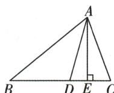

> [!success]- 必刷题
>
> > [!success] **【答案】** 详见解析
>
> > [!note]- **【解析】**
> > 【解】(1)①如图,AE即为所求.∵在△ABC中,∠B=40°,∠C=70°,∴∠BAC=
> >
> > 
> >
> > $180^{\circ} - 40^{\circ} - 70^{\circ} = 70^{\circ}$ . $\because AD$ 是 $\angle BAC$ 的平分线, $\therefore \angle BAD = \frac{1}{2} \angle BAC = 35^{\circ}$ . $\because \angle ADC$ 是 $\triangle ABD$ 的一个外角, $\therefore \angle ADC = \angle B + \angle BAD = 40^{\circ} + 35^{\circ} = 75^{\circ}$ . $\because$ 用三角尺作 $BC$ 边上的高 $AE$ , 垂足为点 $E$ , $\therefore \angle DAE = 90^{\circ} - 75^{\circ} = 15^{\circ}$ .
> > - **②**：$\angle DFE = 15^{\circ}$ . $\because \angle ADC$ 是 $\triangle ABD$ 的一个外角, $\therefore \angle ADC = \angle B + \angle BAD = 40^{\circ} + 35^{\circ} = 75^{\circ}$ . $\because FE \perp BC$ , $\therefore \angle DFE = 90^{\circ} - \angle ADC = 15^{\circ}$ . (2) 不会发生变化. 理由如下: $\because \angle BAD = \frac{1}{2} \angle BAC = 35^{\circ}, \angle B = 40^{\circ}, \angle ADC$ 是 $\triangle ABD$ 的一个外角, $\therefore \angle ADC = \angle B + \angle BAD = 40^{\circ} + 35^{\circ} = 75^{\circ}$ . $\because FE \perp BC$ , $\therefore \angle DFE = 90^{\circ} - \angle ADC = 15^{\circ}, \therefore \angle DFE$ 的度数不会发生变化.
> >
> > (3) 如题图 (4) 所示, $\because$ 在 $\triangle ABC$ 中, $\angle ABC = \alpha, \angle ACB = \beta, \therefore \angle BAC = 180^\circ - \alpha - \beta.$ $\because AD$ 是 $\angle BAC$ 的平分线, $\therefore \angle BAD = \frac{1}{2} \angle BAC = 90^\circ - \frac{\alpha + \beta}{2}.$ $\because \angle ADC$ 是 $\triangle ABD$ 的一个外角, $\therefore \angle ADC = \angle ABC + \angle BAD = \alpha + 90^\circ - \frac{\alpha + \beta}{2} = 90^\circ + \frac{\alpha - \beta}{2}.$ $\because FE \perp AD, \therefore \angle DEF = 90^\circ - \angle ADC = 90^\circ - \left(90^\circ + \frac{\alpha - \beta}{2}\right) = \frac{\beta - \alpha}{2}.$ 如题图 (5) 所示, $\because$ 在 $\triangle ABC$ 中, $\angle ABC = \alpha, \angle ACB = \beta, \therefore \angle BAC = 180^\circ - \alpha - \beta.$ $\because AD$ 是 $\angle BAC$ 的平分线, $\therefore \angle BAD = \frac{1}{2} \angle BAC = 90^\circ - \cfrac{\alpha + \beta}{2}, \therefore \angle ADB = 180^\circ - \angle ABC - \angle BAD = 180^\circ - \alpha - \left(90^\circ - \frac{\alpha + \beta}{2}\right) = 90^\circ - \cfrac{\alpha - \beta}{2}.$ $\because FE \perp AD, \therefore \angle DEF = 90^\circ - \angle ADB = 90^\circ - \left(90^\circ - \cfrac{\alpha - \beta}{2}\right) = \cfrac{\alpha - \beta}{2}.$ 综上所述, $\angle DEF = \frac{\beta - \alpha}{2}$ 或 $\angle DEF = \frac{\alpha - \beta}{2}.$
