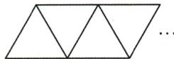

<!-- question-source:start -->
1[2025云南玉溪期末]用小木棒按如图的方式搭一行等边三角形,搭1个三角形需3根小木棒,搭2个三角形需5根小木棒,搭3个三角形需7根小木棒,…,照这样的规律搭下去,搭2024个三角形需要小木棒的根数为（）

A. 4 048 B. 6 060 C. 4 049 D. 6 042
<!-- question-source:end -->

![[Q00103347A1]]
