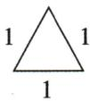
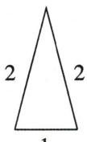
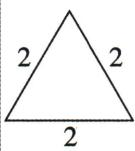

<!-- question-source:start -->
3 AI DPSK 原创 新考法 在平面内, 分别用相同的 3 根, 5 根, 6 根, … 火柴首尾顺次相接, 能搭成什么形状的三角形呢? 通过尝试, 列表如下:

<table><tr><td>火柴根数</td><td>3</td><td>5</td><td>6</td><td>...</td></tr><tr><td>示意图</td><td></td><td>1</td><td></td><td>...</td></tr><tr><td>形状</td><td>等边三角形</td><td>等腰三角形</td><td>等边三角形</td><td>...</td></tr></table>

根据以上信息,解答下列问题:

(1)4 根火柴能搭成三角形吗?

(2)12 根火柴能搭成几种不同形状的三角形?请画出它们的示意图.(提示:如果三角形的三边长 a, b, c 满足 $a^{2} + b^{2} = c^{2}$ , 那么这个三角形是直角三角形)

建议用时 25 分钟 答案 D13
<!-- question-source:end -->

![[Q00103349A1]]
